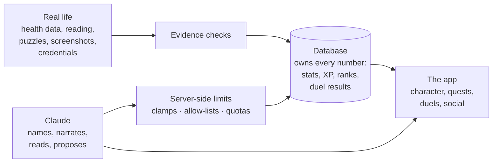

# ⟁ System: Terra

**Your real life is the game.** A life-gamification RPG for iPhone and Android. Lifts become Strength, miles become Endurance, books become Wisdom, and real credentials become Skills. What you actually do decides how you fare when you duel, explore the wilds and meet other players.

By **Adam Hatefi** · [Owrang Studios](https://owrang.io/studios/) · In private beta: [terra.owrang.io](https://terra.owrang.io/) · [Join the beta](https://terra.owrang.io/beta/)

> This is a showcase repository. It describes the game and how it is built; the source code is private and is not included here.

---

## What it is

Most fitness and habit apps hand out points for showing up. Terra turns the evidence of your real life (workouts, runs, reading time, puzzles solved, places visited, certificates earned) into a character that other players can meet, challenge and team up with.

It is **AI-native**. Claude gives the world its voice: it greets you each morning, names your techniques, narrates your battles, reads the screenshots you submit as evidence, and writes a monthly chronicle of who you are becoming. But the AI never decides a number.

> **The Golden Rule: the AI names, narrates and proposes. The database owns every number, every state change and every award.**

## The game

- **Five stats, earned from real evidence.** Strength, Speed, Endurance, Intelligence and Wisdom, each graded F to S and computed from what you actually did: your lifts, a sprint time, a long run or swim, a timed puzzle, your reading hours.
- **A class, written once.** An optional trial sorts you into one of sixteen classes. Your class doesn't change your numbers; it changes how your abilities show up in the story the game writes about you.
- **Skills from real credentials.** Certificates and qualifications become skills, with their depth assessed from the evidence.
- **Quests.** Daily trials, and adventures that use the real world as content: trails, water, escape rooms and gatherings near you, completed by checking in on location. Players can also forge their own quests and publish them for others.
- **Duels.** Challenge other players in classic duels or in turn-based duels with techniques the AI forges for your character. The outcome is computed from both players' real stats.
- **Social.** Friends, chat, parties, hangouts and events, plus profile privacy controls, blocking and reporting.
- **Your own thread with the System.** A running conversation with the game itself, which remembers what you've done.

## How it works

Everything the AI produces passes through server-side limits (allowed values, caps and quotas) before it can touch the game's state. The game's math is written in three places (on the phone, in the server functions and in the database), and an automated check confirms all three agree. The database's copy is the one that counts.

## Built with

| Layer | Tools |
|---|---|
| App | Expo and React Native, TypeScript (strict), expo-router, Reanimated |
| State | Zustand, TanStack Query |
| Backend | Supabase: Postgres, Auth, Storage, Realtime, PostGIS, scheduled jobs, edge functions |
| AI | Anthropic's Claude for text and vision; OpenAI image models for portraits and artwork, and OpenAI's moderation check for reported content |
| Device | Apple HealthKit and Android Health Connect, maps, a native Android module for reading time |
| Payments | App Store and Google Play subscriptions through RevenueCat |
| Phone verification | Twilio Verify |

## How it's kept trustworthy

- **The AI can't touch the score.** No AI output contains an XP value. Where an AI judgment feeds a number, the database bounds it.
- **One set of game math.** The stat formulas are mirrored on the phone, the server and the database, and an automated check fails if they ever disagree.
- **Careful database changes.** Changes are added as new numbered steps and never rewrite history. Each one is rehearsed locally and checks itself when applied.
- **Safety built in.** Reporting and blocking, moderation of reported words and pictures, age gates on adult features, and published privacy, child-safety and account-deletion pages.
- **Built with Claude Code** under a written specification and process, with automated guards and an independent review at every phase.

## Where it stands (November 2026)

In **private beta** in the United States, on iPhone (TestFlight) and Android (Google Play testing). The core game is live (characters, stats, quests, duels, social and the AI "Living System"), and new features ship to testers in regular updates.

---

### About this repository

This repository contains no source code. The System: Terra name, game and code are proprietary.
Copyright © 2026 Adam Hatefi. All rights reserved.
Questions: [owrang.io/contact](https://owrang.io/contact/)
